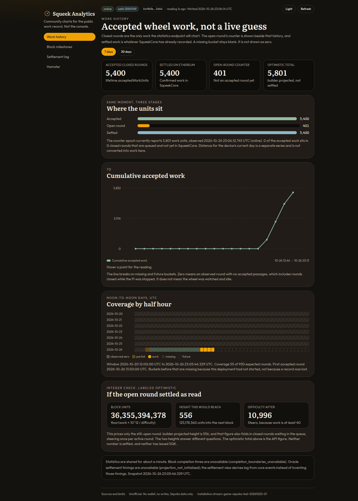

# Squeek Analytics

Unofficial community charts for the [Squeek Chain](https://docs.squeekchain.com/) public work record on Ethereum Sepolia.

The official console already covers live status, wallets, merge, claim, and the leaderboard. This site does not. It follows the dashboard ideas on the [SqueekFi](https://docs.squeekchain.com/rewards/squeekfi/) page: a work-history view, a block-milestone timeline, and a settlement-lag view, plus derived stats for the measured wheel.

It is read-only. There is no wallet connection, no private key, and no transaction.



## Views

| View | What it shows |
|---|---|
| Work history | Accepted closed-round work over half-hour buckets, with missing time left blank. The open-round counter and the settled total sit beside that history. An integer price-then-steer check is labeled optimistic. |
| Block milestones | Certified frontier against completed Squeek-block height. The 40-block figure is the difficulty steering target, not a quota. |
| Settlement lag | How long closed rounds still in the queue have waited, then seconds from a round's end to the Ethereum block that certified it, plus checkpoint delay where the API lists a matching checkpoint. |
| Hamster | Latest rpm, speed, day distance, an implied circumference from that paired reading, records, coverage, and measurement milestones. |

Screenshots of the other views: [block milestones](docs/screenshots/block-milestones.png), [settlement lag](docs/screenshots/settlement-lag.png), [hamster](docs/screenshots/hamster.png).

## Run it

Requirements: Node 22+, pnpm 10.

```sh
pnpm install
pnpm dev
```

The dev server listens on [http://127.0.0.1:47221](http://127.0.0.1:47221). In development the page calls same-origin `/squeek-api`, and the Vite server forwards that to `https://api.squeekchain.com` with Node's `fetch`. A production build does not use that proxy: the browser calls the API directly.

**Optional, dev only.** Some networks answer Node's `fetch` with a Cloudflare challenge. If that happens, the dev server tries `apps/site/scripts/upstream.py`, which needs Python 3 and [`curl_cffi`](https://pypi.org/project/curl-cffi/) (`pip install curl_cffi`). You do not need that package to install, test, typecheck, or build, and a normal browser never uses it. If the helper is missing, the dev proxy returns the upstream error and the static site is unaffected.

```sh
pnpm lint
pnpm typecheck
pnpm test
pnpm build
```

`pnpm build` writes a static site to `apps/site/dist` with base `/`, then copies that folder to `dist` at the repository root. Set `VITE_BASE=/squeek-analytics/` for the GitHub project-pages build. The production bundle calls `https://api.squeekchain.com` from the browser (CORS is open; no API key). `dist/404.html` is a copy of `index.html`, so a host that serves it for unknown paths keeps client routes such as `/blocks` working. `apps/site/public/_redirects` and `apps/site/public/vercel.json` are copied into that folder for other static hosts.

Override the API origin with `VITE_API_BASE`. Override the Sepolia HTTP endpoint with `VITE_SEPOLIA_RPC` (default `https://ethereum-sepolia-rpc.publicnode.com`). The page only reads logs when `/v1/core` events do not already connect back to round 0.

## Published site

The live site is [https://mertonghen-lang.github.io/squeek-analytics/](https://mertonghen-lang.github.io/squeek-analytics/).

Pushing to `main` runs typecheck and tests, builds `apps/site/dist` with `VITE_BASE=/squeek-analytics/`, and deploys that folder to GitHub Pages. Pull requests run the same checks and do not deploy. The workflow uses the public API only, so it needs no secrets. Pages has to be set once to **GitHub Actions** as the source (Settings → Pages → Build and deployment → Source).

## Deploy to Vercel

Import this repository and leave the root directory as the repository root. The Hobby plan needs no environment variables, secrets, or analytics. The root [`vercel.json`](vercel.json) installs with pnpm, runs `pnpm build`, publishes the root `dist` folder (the same files as `apps/site/dist`), and rewrites every route to `/index.html`. That build uses base `/`, so the site is served from the domain root. The browser calls `https://api.squeekchain.com` directly.

## Data sources

Public `GET` API: `https://api.squeekchain.com/v1`.

| View | Calls |
|---|---|
| Work history | `/v1/measurement/stats?range=7d\|30d`, `/v1/status`, `/v1/core` |
| Block milestones | `/v1/core`, `/v1/settlements?range=24h`, `/v1/status` |
| Settlement lag | `/v1/core` (`BatchSettled` timestamps), `/v1/settlements` (checkpoints), `/v1/status` (latest submission). Sepolia `eth_getLogs` only if that event list does not reach round 0. |
| Hamster | `/v1/status`, `/v1/measurement/stats`, `/v1/events?category=measurement` |

Decimal strings (work, block units, round ids, base units) stay strings until `toUint` parses them as `bigint`. The client retries 429, 503, and 504 using `Retry-After`. An HTTP 200 body with `"status": "unavailable"` is shown as unknown, not as zero. Missing half-hour buckets are gaps, not zeros.

`GET /v1/mining/state` and the owner routes are typed in `@squeek-analytics/client`. This site does not depend on them. Mining state has returned `404`. `GET /v1/economy/state` is wrapped because it is live, but it is not in the attached docs snapshot, which documents `/v1/mining/state` instead.

Contract addresses come from the live `/v1/core` `identities` object. The docs snapshot this repo was written against names SqueekCore `0x74665dAecA35A2303e767E76a2FF1FB6F93e119f` and deployment block `11902282`. The live API has reported a different core proxy and deployment block. The Sources page prints both. Nothing is hard-coded for reads.

## Library

[`packages/squeek-client`](packages/squeek-client/README.md) is a small typed client: endpoint methods, error types, ETag replay, pagination, and the integer helpers the charts use (price-then-steer, noon-wrapped work series, settlement lag). It is `"private": true` and is not published to npm.

```ts
import { SqueekClient, toUint } from "@squeek-analytics/client";

const client = new SqueekClient();
const status = await client.getStatus();
const openRound = status.builder.queued
  ? toUint(status.builder.queued.openRoundWorkUnits)
  : null;
```

## Limits

- Optimistic builder projections are not settled work and have not issued SQK.
- A zero-work round was closed with no accepted passages. That includes time the Pi was stopped. It does not prove the wheel was watched.
- A missing record proves nothing. The charts do not fill it in.
- RPM, speed, and distance are estimates from magnet passages. Circumference on the hamster view is integer division of one paired reading, not a second measurement.
- The API does not publish a passage-level RPM history, so there is no speed timeline.
- Chain figures wait for about 12 confirmations.
- The page refetches about once a minute.

## Disclaimer

Squeek Analytics is an unofficial community project. It is not affiliated with, endorsed by, or operated by Squeek Chain. Data can be reorged, paused, or replaced while the contracts are in active development. Do not use it to prepare a claim, merge, or any other transaction. Read the contracts yourself for that.

## License

[MIT](LICENSE)
